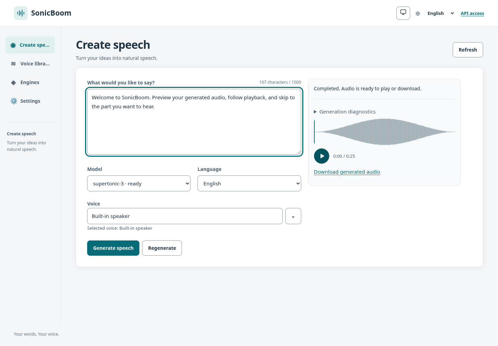
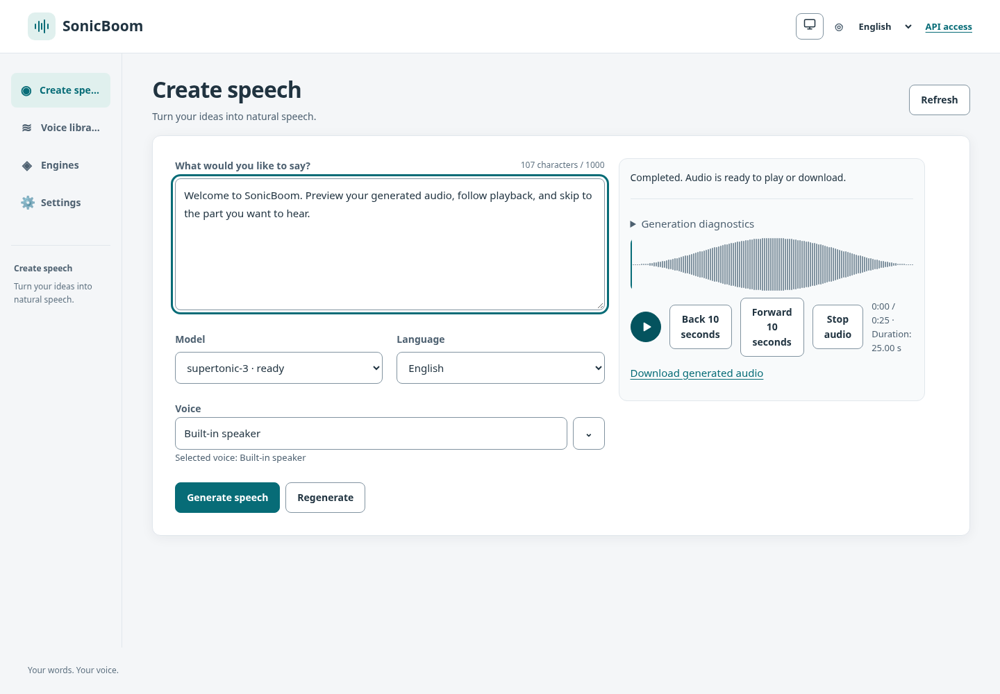
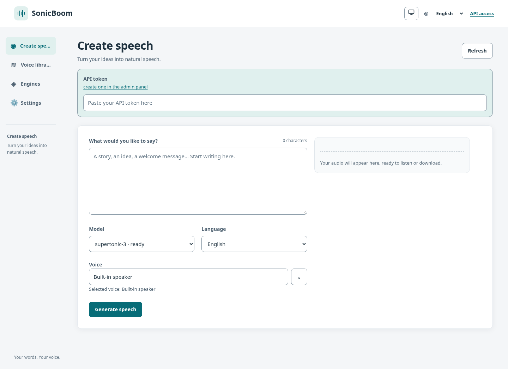
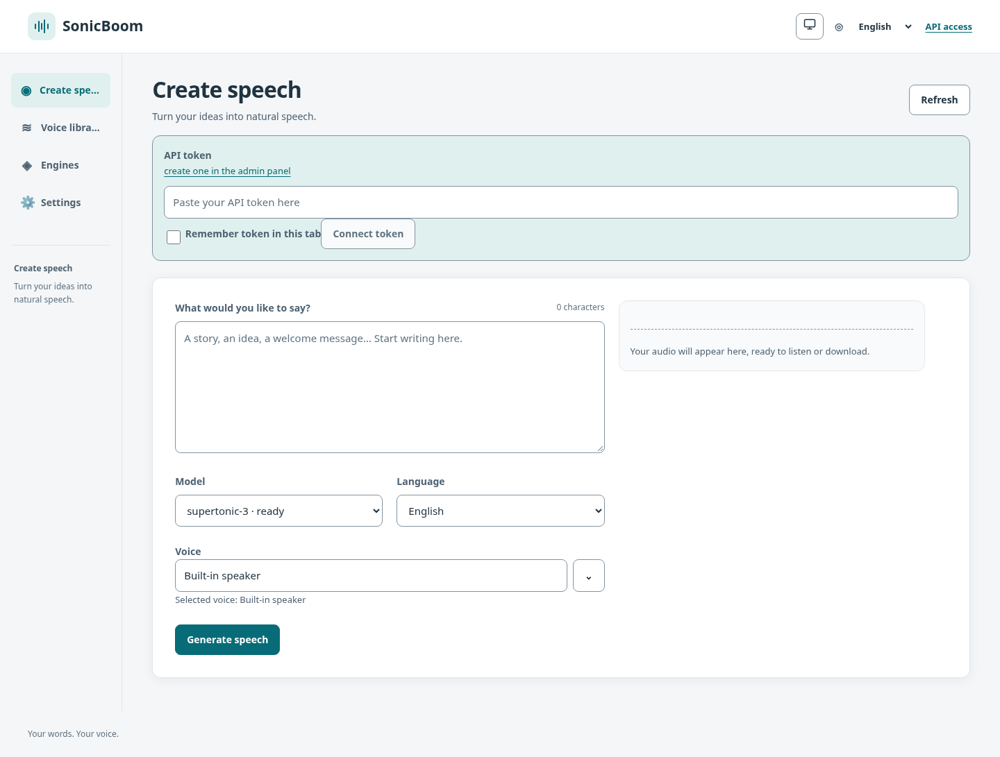
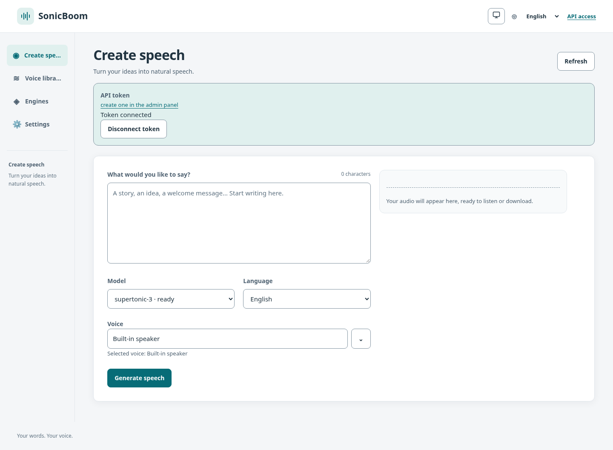

# Audio controls and token connection screenshots

Captured in Chromium at a 1440 × 1000 viewport, English, light theme, reduced motion.
Both versions use production frontend builds and the repository's CSP-enabled
Playwright fixture server. Before: `0ada000`; after: `f355e94`.

The audio is the same synthetic 25-second test tone in both versions. API responses
and token validation use fixtures; no live model or real credentials are involved.
These captures demonstrate browser rendering and the connected UI state, not live
server authentication or speech quality.

| Change | Before | After |
| --- | --- | --- |
| Playback controls and decoded duration |  |  |
| Token connection form |  |  |

Connected state after submitting a dummy token against the fixture endpoint:

